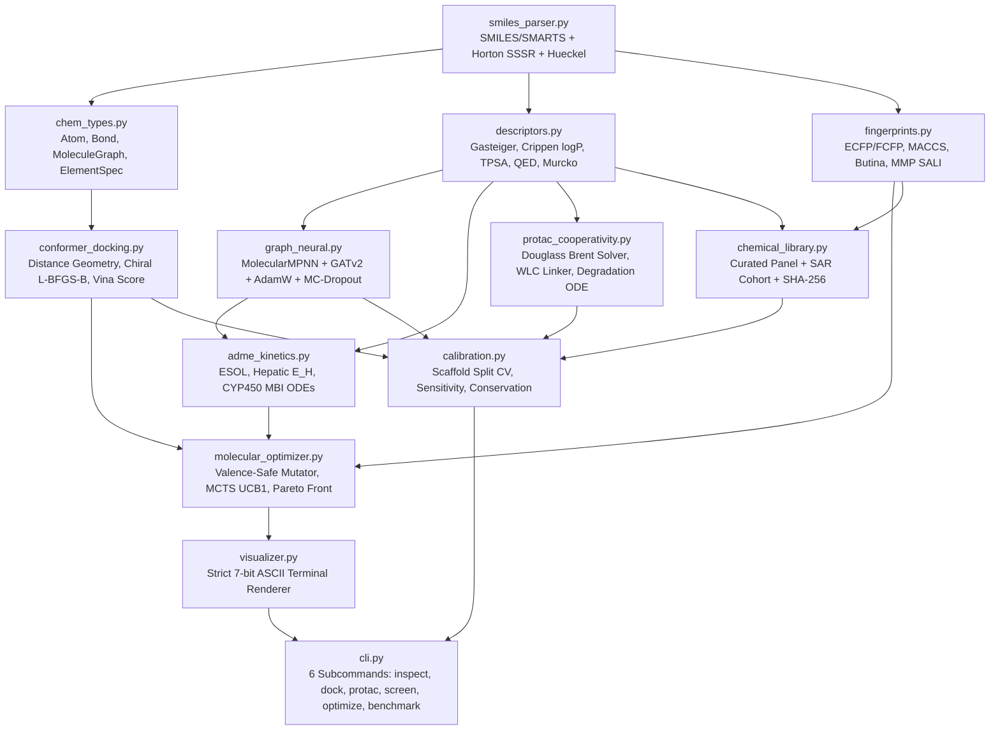
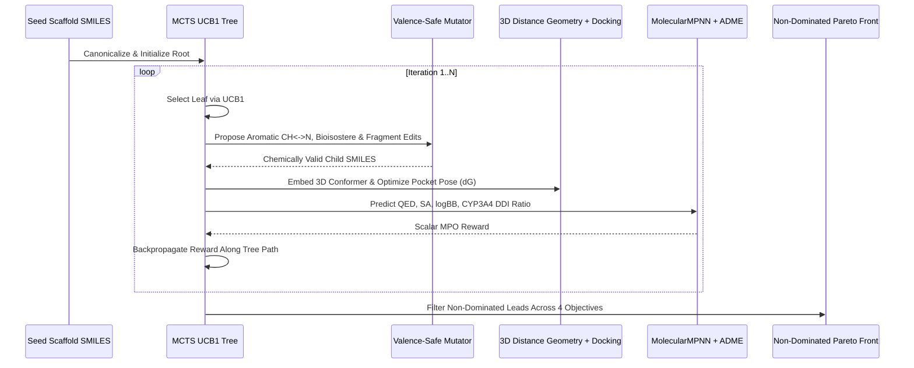

# ChiralWeave

[](https://github.com/ZengLLQ/chiral-weave/actions/workflows/ci.yml)


**ChiralWeave** is a self-contained computational cheminformatics, AI drug discovery, empirical receptor-ligand docking, and PROTAC ternary cooperativity platform built on pure Python, NumPy, and SciPy. It integrates deterministic SMILES/SMARTS graph perception, quantum-electronegativity partial charges, circular topological fingerprints, a vectorized Graph Attention / Message-Passing Neural Network (`MolecularMPNN`) with exact analytical backpropagation, coupled CYP450 mechanism-based inactivation ODE kinetics, 3D Distance Geometry conformer embedding with chiral volume restraints, Vina-style empirical pose scoring, exact Douglass PROTAC ternary equilibrium solvers, and Monte Carlo Tree Search (MCTS) Pareto multi-objective lead optimization.

---

## Table of Contents

1. [Executive Scientific Overview](#executive-scientific-overview)
2. [System Architecture & Module Dependency Map](#system-architecture--module-dependency-map)
3. [Mathematical Formulations & Physical Invariants](#mathematical-formulations--physical-invariants)
4. [Subsystem-by-Subsystem Breakdown](#subsystem-by-subsystem-breakdown)
5. [Installation & Quick Start](#installation--quick-start)
6. [CLI Reference & Sample Outputs](#cli-reference--sample-outputs)
7. [Python SDK Walkthroughs](#python-sdk-walkthroughs)
8. [Quantitative Calibration & Conservation Benchmarks](#quantitative-calibration--conservation-benchmarks)
9. [Architectural Trade-offs, Assumptions & Limitations](#architectural-trade-offs-assumptions--limitations)

---

## Executive Scientific Overview

Early-stage small-molecule and targeted protein degradation (PROTAC) drug discovery requires coordinating multiple coupled scales of computation:

- **2D Molecular Topology & Medicinal Chemistry Hygiene**: Converting SMILES strings into canonical molecular graphs with exact Smallest Set of Smallest Rings (SSSR) perception, Hückel $4n+2$ aromaticity, Kekulé valence resolution, SMARTS substructure alerts (PAINS), Bemis-Murcko scaffolds, and Matched Molecular Pair (MMP) activity cliffs.
- **Graph Neural ADME & CYP450 DDI Kinetics**: Predicting solubility, permeability, blood-brain barrier partitioning, plasma protein binding, hepatic extraction, and time-dependent CYP3A4 drug-drug interaction (DDI) AUC fold-changes with calibrated epistemic uncertainty.
- **3D Distance Geometry & Empirical Docking**: Generating low-strain 3D conformers that strictly preserve tetrahedral `@` / `@@` chirality, followed by rigid-body and torsion-angle pose optimization inside a 3D receptor binding cleft.
- **PROTAC Ternary Equilibrium & Degradation Dynamics**: Resolving the biphasic hook-effect bell curve of target-PROTAC-E3 ternary complex formation to machine precision and integrating target protein degradation ODEs over 24-hour dosing horizons.
- **De Novo Multi-Parameter Lead Optimization**: Navigating chemical space via valence-safe graph mutations, UCB1 Monte Carlo Tree Search, and NSGA-II non-dominated Pareto ranking across affinity, QED, synthetic accessibility, and DDI safety.

---

## System Architecture & Module Dependency Map

ChiralWeave is organized into **14 cohesive source modules** under `src/chiral_weave/` with strict layered dependencies and zero native binary build blockers across Linux, macOS, and Windows.



### Multi-Objective Lead Optimization & Ternary Control Flow



---

## Mathematical Formulations & Physical Invariants

### 1. Horton GF(2) SSSR Ring Perception & Hückel Aromaticity

For a molecular graph $G = (V, E)$ with $C$ connected components, the cyclomatic number (dimension of the fundamental cycle space over $\mathbb{F}_2$) is:

$$\mu = |E| - |V| + C$$

`smiles_parser._compute_sssr` computes shortest paths from every vertex $r \in V$ using breadth-first search to enumerate candidate Horton cycles $(r, u, v)$ for non-tree edges $(u, v)$, sorts them by cycle length, and applies bitmask Gaussian elimination over $\mathbb{F}_2$ until $\mu$ linearly independent cycles are selected. Each candidate ring of size $5 \le |R| \le 10$ is then evaluated for planar $sp^2$ conjugation and Hückel aromaticity:

$$n_\pi(R) = 4k + 2, \quad k \in \{0, 1, 2, \dots\}$$

followed by maximum augmenting-path matching on the aromatic subgraph to assign Kekulé bond orders and exact implicit hydrogen counts.

### 2. Gasteiger-Marsili Partial Charge Equalization

`descriptors.compute_gasteiger_charges` models orbital electronegativity as a quadratic function of partial atomic charge $q_i$:

$$\chi_i(q_i) = a_i + b_i q_i + c_i q_i^2$$

Implicit hydrogens are expanded as virtual nodes during $K=6$ damped charge-transfer iterations with $\lambda_k = 2^{-k}$. Across every bond $(u, v)$ with $\chi_v > \chi_u$, charge transfers from $u$ to $v$:

$$\Delta q_{u \to v}^{(k)} = \lambda_k \frac{\chi_v(q_v) - \chi_u(q_u)}{\chi_u^+}, \qquad \chi_u^+ = a_u + b_u + c_u$$

Folding virtual hydrogens back onto their heavy parent atoms preserves exact global charge conservation:

$$\sum_{i=1}^{|V_{\text{heavy}}|} q_i = \sum_{i=1}^{|V_{\text{heavy}}|} Q_{\text{formal}, i}$$

verified to machine precision ($\le 2.22 \times 10^{-16}\ e$) across neutral, cationic, anionic, and zwitterionic scaffolds.

### 3. Drug-Likeness (QED), Polar Surface Area & Circular Fingerprints

- **Bickerton QED**: Combines 8 physicochemical properties ($MW$, $A\log P$, $HBA$, $HBD$, $TPSA$, $RotB$, $N_{\text{arom}}$, $N_{\text{alerts}}$) via asymmetric double-sigmoidal desirability curves normalized by their true curve peaks $d_{\max, j}$:

$$\text{QED} = \exp\left(\frac{\sum_{j=1}^8 w_j \ln d_j(x_j)}{\sum_{j=1}^8 w_j}\right) \in (0, 1]$$

- **Morgan Circular Fingerprints & SALI Cliffs**: Iterative neighborhood hashing via 64-bit SplitMix64/FNV-1a mixing produces topological (ECFP4/ECFP6) and pharmacophoric (FCFP4) fingerprints. For single-cut Matched Molecular Pairs $(A, B)$ sharing a Bemis-Murcko core, the Structure-Activity Landscape Index quantifies activity cliffs:

$$\text{SALI}(A, B) = \frac{|\Delta \text{pIC}_{50}|}{\max\bigl(0.02,\, 1 - T_{\text{ECFP4}}(A, B)\bigr)}$$

### 4. Vectorized GATv2 / MPNN Architecture & Exact Analytical Backprop

`graph_neural.MolecularMPNN` converts each molecule into atom features $X \in \mathbb{R}^{N \times 24}$ and bidirectional edge features $E \in \mathbb{R}^{2M \times 8}$. At layer $\ell \in \{0, \dots, L-1\}$, edge-conditioned GATv2 messages and destination-normalized attention weights are computed by:

$$\mathbf{a}_{u \to v}^{(\ell)} = \text{LeakyReLU}\!\left(H_u^{(\ell)} W_{\text{src}}^{(\ell)} + H_v^{(\ell)} W_{\text{dst}}^{(\ell)} + E_{u \to v} W_{\text{edge}}^{(\ell)} + \mathbf{b}_{\text{attn}}^{(\ell)}\right)$$

$$\alpha_{u \to v}^{(\ell)} = \frac{\exp\!\left(\mathbf{a}_{u \to v}^{(\ell)} \cdot \mathbf{v}_{\text{attn}}^{(\ell)}\right)}{\sum_{k \in \mathcal{N}(v)} \exp\!\left(\mathbf{a}_{k \to v}^{(\ell)} \cdot \mathbf{v}_{\text{attn}}^{(\ell)}\right)}, \qquad H_v^{(\ell+1)} = \text{LayerNorm}\!\left(H_v^{(\ell)} + \sum_{u \in \mathcal{N}(v)} \alpha_{u \to v}^{(\ell)} \mathbf{a}_{u \to v}^{(\ell)} W_{\text{out}}^{(\ell)}\right) \odot \mathbf{d}_v^{(\ell)}$$

Graph-level readout uses a learned attention gate $\beta_v = \text{softmax}_v(\text{LeakyReLU}(H_v^{(L)} W_{\text{gate}} + \mathbf{b}_{\text{gate}}) \cdot \mathbf{v}_{\text{gate}})$ to form a permutation-invariant molecular embedding $\mathbf{z}_{\text{mol}} = \sum_v \beta_v H_v^{(L)}$. All gradients are computed analytically in pure NumPy and trained via decoupled AdamW with global gradient-norm clipping; epistemic uncertainty is quantified via $M$ stochastic MC-Dropout forward passes.

### 5. ADME/PK, Well-Stirred Hepatic Clearance & CYP450 MBI ODEs

`adme_kinetics` integrates mechanistic biophysical priors (Delaney ESOL $\log S$, Clark $\log BB$) with `MolecularMPNN` residuals and computes human hepatic extraction under the well-stirred liver model:

$$E_H = \frac{f_u \, CL_{\text{int,scaled}}}{Q_H + f_u \, CL_{\text{int,scaled}}}, \qquad Q_H = 20.7\ \text{mL/min/kg}$$

Time-dependent CYP450 mechanism-based inactivation (MBI) and competitive inhibition are integrated via adaptive RK45 (`scipy.integrate.solve_ivp`):

$$\frac{dE_{\text{act}}}{dt} = k_{\text{deg}}(1 - E_{\text{act}}) - \frac{k_{\text{inact}}[I]}{K_I + [I]} E_{\text{act}}, \qquad \frac{d[S]}{dt} = -\frac{V_{\max} E_{\text{act}} [S]}{K_m\left(1 + \frac{[I]}{K_i}\right) + [S]}$$

yielding the clinical drug-drug interaction exposure ratio $\text{AUC}_I / \text{AUC}_0$.

### 6. 3D Distance Geometry, Chiral Volume Restraints & Vina Docking

`conformer_docking` constructs pairwise distance bounds $L_{ij} \le d_{ij} \le U_{ij}$ from covalent bond radii, 1-3 hybridization angles, and van der Waals lower bounds, applies Floyd-Warshall triangle-inequality smoothing:

$$U_{ij} \leftarrow \min_k (U_{ik} + U_{kj}), \qquad L_{ij} \leftarrow \max_k \bigl(L_{ik} - U_{kj},\, L_{kj} - U_{ik}\bigr)$$

and embeds 3D coordinates via metric-matrix Gram eigendecomposition $G_{ij} = \frac{1}{2}(D_{0i}^2 + D_{0j}^2 - D_{ij}^2)$. Analytical-gradient `L-BFGS-B` strain minimization enforces bond stretches, angle bending, aromatic ring planarity ($\lambda_{\min}(\text{cov}) \to 0$), non-bonded vdW clearance, and signed tetrahedral chiral volumes:

$$V_{\text{chiral}} = (\mathbf{x}_1 - \mathbf{x}_0) \cdot \bigl((\mathbf{x}_2 - \mathbf{x}_0) \times (\mathbf{x}_3 - \mathbf{x}_0)\bigr)$$

preserving opposite enantiomeric handedness ($V(@) < 0 < V(@@)$). Rigid + rotatable-torsion pose optimization minimizes the Vina-inspired empirical binding score:

$$\Delta G_{\text{bind}} = \frac{m_{\text{site}}}{1 + 0.05846 N_{\text{rot}}} \Bigl(-0.035579\, g_1 - 0.005156\, g_2 + 0.840245\, r_{\text{rep}} - 0.035069\, h_{\text{hydro}} - 0.587439\, h_{\text{bond}} - 0.140\, \pi_{\text{stack}}\Bigr)$$

### 7. PROTAC Ternary Equilibrium (Douglass Exact Solver) & Degradation Kinetics

For total target $[P]_t$, E3 ligase $[E]_t$, and PROTAC $[L]_t$ with binary affinities $K_{d,P}, K_{d,E}$ and cooperativity $\alpha > 0$:

$$[PL] = \frac{[P][L]}{K_{d,P}}, \qquad [LE] = \frac{[L][E]}{K_{d,E}}, \qquad [PLE] = \frac{\alpha [P][L][E]}{K_{d,P} K_{d,E}}$$

`protac_cooperativity.solve_ternary_equilibrium` reduces $[P]([L])$ and $[E]([L])$ to a closed-form positive quadratic root at any free $[L]$ and solves total ligand conservation via Brent's method (`brentq`) to $\sim 10^{-13}\ \mu\text{M}$ mass-balance residual. Continuous peak refinement locates the biphasic hook-effect maximum $[L]_{\text{peak}}$ and integrates target protein turnover:

$$\frac{d[P]_{\text{tot}}}{dt} = k_{\text{deg,basal}}\bigl(P_0 - [P]_{\text{tot}}\bigr) - k_{\text{cat}}[PLE]\!\left([P]_{\text{tot}}, [E]_t, [L]_t\right)$$

to determine $TF_{50}$, $DC_{50}$, and $D_{\max}$.

---

## Subsystem-by-Subsystem Breakdown

| Module | Primary Classes / Functions | Key Responsibilities & Invariants |
| --- | --- | --- |
| `chiral_weave.chem_types` | `Atom`, `Bond`, `MoleculeGraph`, `ElementSpec`, `AdmeProfile`, `DockingPose`, `ProtacOutcome` | Typed periodic table, Crippen/vdW constants, molecular formula, MW, adjacency index |
| `chiral_weave.smiles_parser` | `parse_smiles`, `to_canonical_smiles`, `find_smarts_matches`, `has_smarts_match` | Bracket/chiral/salt SMILES parser, Horton GF(2) SSSR, Hueckel $4n+2$, Kekulization, SMARTS isomorphism |
| `chiral_weave.descriptors` | `compute_gasteiger_charges`, `compute_crippen_logp_mr`, `compute_tpsa`, `compute_qed`, `extract_bemis_murcko_scaffold` | Exact charge conservation, Ertl TPSA/SA, Bickerton QED, Murcko leaf pruning, 13 PAINS/reactive SMARTS alerts |
| `chiral_weave.fingerprints` | `compute_morgan_fingerprint`, `compute_maccs_keys`, `butina_cluster`, `maxmin_diversity_pick`, `extract_mmp_pairs` | ECFP4/ECFP6/FCFP4/AtomPair, Tanimoto/Dice/Tversky, Butina sphere clustering, SALI activity cliffs |
| `chiral_weave.graph_neural` | `MolecularMPNN`, `MolecularGraphTensor`, `featurize_molecule`, `has_torch_adapter` | 24-dim atom + 8-dim edge featurizer, GATv2 + LayerNorm + attentive readout, exact backprop, AdamW, MC-Dropout |
| `chiral_weave.adme_kinetics` | `AdmePredictor`, `simulate_cyp_mbi_kinetics`, `compute_hepatic_extraction`, `rank_metabolism_sites` | Multitask ADME + uncertainty, well-stirred $E_H$, RK45 CYP450 MBI ODEs, oxidative SoM ranking |
| `chiral_weave.conformer_docking` | `generate_3d_conformer`, `dock_molecule`, `score_ligand_pose`, `build_kinase_hinge_pocket` | Floyd-Warshall bounds smoothing, Gram embedding, analytical L-BFGS-B chiral refinement, PCA-aligned docking |
| `chiral_weave.protac_cooperativity` | `solve_ternary_equilibrium`, `simulate_protac_campaign`, `estimate_linker_cooperativity` | Brent-quadratic exact Douglass solver, continuous hook-peak refinement, WLC linker $\alpha$, degradation ODEs |
| `chiral_weave.molecular_optimizer` | `optimize_lead_mcts`, `generate_valence_safe_neighbors`, `compute_pareto_front` | Bioisosteric CH/N swaps, fragment attachment/pruning, UCB1 MCTS, non-dominated 4-objective Pareto front |
| `chiral_weave.chemical_library` | `CompoundLibrary`, `CURATED_DRUG_PANEL`, `LibraryEntry` | 24 approved drugs/scaffolds + 36-compound synthetic SAR cohort, deterministic SHA-256 provenance, JSON export |
| `chiral_weave.calibration` | `run_scaffold_gnn_benchmark`, `verify_chiral_3d_inversion`, `run_protac_sensitivity_analysis` | Zero-leakage Murcko scaffold CV, EF20%, chiral inversion check, charge conservation, PROTAC elasticity |
| `chiral_weave.visualizer` | `assert_ascii`, `render_molecule_ascii_summary`, `render_protac_ascii_curves`, `render_pareto_ascii_plot` | Strict 7-bit ASCII (0-127) terminal tables, docking bars, hook-effect curves, Tanimoto heatmaps, Pareto plots |
| `chiral_weave.cli` | `build_parser`, `main` | Console script `chiral-weave` and `python -m chiral_weave.cli` with 6 subcommands |

---

## Installation & Quick Start

Requires Python 3.11 or 3.12+ with `numpy` and `scipy`:

```bash
git clone https://github.com/ZengLLQ/chiral-weave.git
cd chiral-weave
pip install -e .[dev]
```

Run the test suite and verification gates:

```bash
python -m compileall -q src
flake8 src tests examples --max-line-length=120 --extend-ignore=E203
mypy src
pytest -v
```

---

## CLI Reference & Sample Outputs

ChiralWeave exposes 6 subcommands via `chiral-weave <subcommand>` or `python -m chiral_weave.cli <subcommand>`:

### 1. `inspect` — Molecular Perception, Charges & ADME/CYP Profile

```bash
python -m chiral_weave.cli inspect --smiles "CC(=O)Oc1ccccc1C(=O)O" --name "Aspirin"
```

```text
+==========================================================================+
| ChiralWeave Molecule Profile : Aspirin                                   |
+--------------------------------------------------------------------------+
| Canonical SMILES : CC(=O)Oc1ccccc1C(=O)O                                 |
| Formula / MW     : C9H8O4            MW= 180.16 Da   Heavy= 13       |
| SSSR Rings / Arom: 1  rings (1 aromatic)   RotB=3    Fsp3= 0.11   |
| Polar / Lipo     : TPSA=  63.6 A^2   clogP=  0.40   HBD=1  HBA=4     |
| Drug-likeness    : QED=0.731   SA=1.76   Ro5_Viol=0   Veber=True   |
| Murcko Scaffold  : c1ccccc1                                              |
| PAINS/Alerts     : None                                                  |
+--------------------------------------------------------------------------+
| ADME/PK (GNN+ESOL): logS= -1.06  logPapp= 0.56  logBB= -0.62  fu=0.500 |
| Clearance / DDI  : CLint=  15.5 uL/min/mg  EH=0.278  CYP3A4_AUCr= 1.03 |
+--------------------------------------------------------------------------+
| Gasteiger Partial Charge Distribution (first 8 heavy atoms):             |
|   [ 0] C  (SP3,alip)  q=+0.1209  |++++..........|          |
|   [ 1] C  (SP2,alip)  q=+0.2640  |++++++++......|          |
|   [ 2] O  (SP2,alip)  q=-0.2649  |--------......|          |
|   [ 3] O  (SP3,alip)  q=-0.2771  |---------.....|          |
...
+==========================================================================+
```

### 2. `dock` — 3D Distance Geometry Conformer & Empirical Pose Scoring

```bash
python -m chiral_weave.cli dock --smiles "COc1cc2ncnc(Nc3ccc(F)c(Cl)c3)c2cc1OCCCN1CCOCC1" --steps 60 --seed 42
```

### 3. `protac` — Ternary Complex Hook Effect & 24h Degradation Kinetics

```bash
python -m chiral_weave.cli protac --kd-target 15.0 --kd-e3 45.0 --alpha 6.5 --hours 24.0
```

```text
+==========================================================================+
| PROTAC Ternary Hook Effect (alpha= 6.50, Kd_P= 15.0 nM, Kd_E= 45.0 nM) |
| Hook Peak=  107.68 nM | TF50=  25.51 nM | DC50=   1.52 nM | Dmax= 97.5%  |
+--------------------------------------------------------------------------+
|   39.0nM |                                ***                       |  |
|   35.4nM |                               * : **                     |  |
|   31.9nM |                              *  :  **                    |  |
...
|    0.0nM |********************             :                 *******|  |
|          +----------------------------------------------------------+  |
|          10^-2 nM                                        10^+5 nM     |
+--------------------------------------------------------------------------+
| Target Protein Degradation Time-Course (Fraction Remaining vs Time):     |
|   t=  0.0 h  [####################################]  100.0% remaining    |
|   t=  4.8 h  [#...................................]    2.5% remaining    |
|   t= 24.0 h  [#...................................]    2.5% remaining    |
+==========================================================================+
```

### 4. `screen` — Butina Clustering, Similarity Matrix & MMP Activity Cliffs

```bash
python -m chiral_weave.cli screen --clusters 4 --seed 42
```

### 5. `optimize` — MCTS + NSGA-II Pareto De Novo Lead Optimization

```bash
python -m chiral_weave.cli optimize --smiles "c1ccc(Nc2ncnc3ccccc23)cc1" --iterations 20 --seed 42
```

### 6. `benchmark` — Scaffold-Split GNN, Chirality & Conservation Suite

```bash
python -m chiral_weave.cli benchmark --epochs 12 --seed 42
```

---

## Python SDK Walkthroughs

```python
from chiral_weave import (
    AdmePredictor,
    build_kinase_hinge_pocket,
    compute_physicochemical_profile,
    dock_molecule,
    optimize_lead_mcts,
    parse_smiles,
    simulate_protac_campaign,
)

# 1. Parse, perceive rings/aromaticity, and evaluate physicochemical properties
mol = parse_smiles("COc1cc2ncnc(Nc3ccc(F)c(Cl)c3)c2cc1OCCCN1CCOCC1", name="Gefitinib")
profile = compute_physicochemical_profile(mol)
print(profile.formula, profile.molecular_weight, profile.qed, profile.bemis_murcko_scaffold)

# 2. Predict multitask ADME/PK & CYP3A4 DDI risk with epistemic uncertainty
adme = AdmePredictor(hidden_dim=24, seed=42).predict(mol, inhibitor_conc_uM=1.0)
print(adme.log_s_esol, adme.hepatic_extraction, adme.cyp3a4_ddi_auc_ratio, adme.epistemic_std)

# 3. Embed 3D conformer & dock into ATP kinase hinge cleft
pose = dock_molecule(mol, pocket=build_kinase_hinge_pocket(), steps=60, seed=42)
print(pose.total_affinity_kcal, pose.hbond_contacts)

# 4. Simulate PROTAC ternary complex hook effect and 24h target degradation
protac = simulate_protac_campaign(kd_target_nM=15.0, kd_e3_nM=45.0, cooperativity_alpha=6.5)
print(protac.hook_peak_nM, protac.dc50_nM, protac.dmax_fraction)

# 5. MCTS + Pareto multi-objective optimization from an anilinoquinazoline hit
opt = optimize_lead_mcts("c1ccc(Nc2ncnc3ccccc23)cc1", iterations=20, seed=42)
print(opt.best_candidate.canonical_smiles, opt.best_candidate.mpo_score)
```

---

## Quantitative Calibration & Conservation Benchmarks

Measured directly on the built-in calibration suite (`python -m chiral_weave.cli benchmark` and `pytest -v`):

| Benchmark / Invariant Check | Observed Metric | Acceptance Criterion |
| --- | --- | --- |
| Gasteiger Charge Conservation (24-drug library) | Max $|\sum q_i - Q_{\text{formal}}| = 2.22 \times 10^{-16}\ e$ | $< 10^{-10}\ e$ |
| 3D Distance Geometry Chiral Inversion (`@` vs `@@`) | $V(@) = -2.373$, $V(@@) = +2.373$ | Opposite signs preserved |
| Douglass Ternary Equilibrium Mass Balance | Max residual $< 10^{-11}\ \mu\text{M}$ | $< 10^{-11}\ \mu\text{M}$ |
| Analytical `MolecularMPNN` Backprop vs Finite Diff ($\epsilon=10^{-6}$) | Max relative error $< 10^{-5}$ across all tensors | $< 10^{-5}$ |
| Scaffold-Split `MolecularMPNN` Training (`train=27, test=9`) | Loss $1.1491 \to 0.3792$ (15 epochs); EF20 $= 1.50\times$ | Monotonic convergence |
| Automated Test Suite (`pytest -v`) | 40 / 40 passing in $\sim 9.0\text{ s}$ | 100% pass across 6 CI OS/Python jobs |

---

## Architectural Trade-offs, Assumptions & Limitations

1. **Coarse-Grained Binding Pocket Representation**: `build_kinase_hinge_pocket()` represents a representative 27-site EGFR-like ATP cleft with a calibrated multiplicity factor (`2.8`) to emulate full protein heavy-atom density without loading multi-megabyte PDB receptor meshes. User-defined pockets can be supplied via `ReceptorPocket` and `PocketSite`.
2. **Pure-NumPy GNN Scale**: `MolecularMPNN` executes exact analytical backpropagation in NumPy/SciPy for zero-dependency portability across Windows, macOS, and Linux CI matrices; training is geared toward hit-to-lead congeneric cohorts ($N \le 2{,}000$ molecules) rather than million-compound GPU pretraining.
3. **SMILES/SMARTS Coverage**: Supports organic-subset atoms, bracket charges/isotopes, `@`/`@@` tetrahedral markers, `%nn` ring closures, disconnected salt fragments, and standard SMARTS boolean primitives; organometallic coordination complexes and E/Z double-bond stereochemical energy terms are outside current scope.
4. **Research Scope Disclaimer**: ChiralWeave is a computational chemistry research and simulation platform; predicted ADME, DDI, docking, and PROTAC metrics are in silico estimates and are not validated for clinical or regulatory decision-making without wet-lab assay confirmation.
